# xrwvm-fullstack_developer_capstone

## Project Name: fullstack_developer_capstone
**Cars Dealership - Full Stack Cloud Development Capstone Project**

## Repository Details
- **Repository name:** xrwvm-fullstack_developer_capstone  
- **Project name:** fullstack_developer_capstone  

This project was completed as part of the IBM Full Stack Software Developer Capstone Project.

## Project Overview
Cars Dealership is a national car retailer web application that allows users to browse dealership locations across the United States, view dealer details and customer reviews, submit reviews with sentiment analysis, and manage user authentication.

## Technologies Used
- **Frontend:** React, HTML5, CSS3, JavaScript, Bootstrap
- **Backend:** Django, Python, Node.js, Express, Flask
- **Database:** MongoDB, SQLite
- **DevOps & Cloud:** Docker, Kubernetes, IBM Cloud Code Engine, GitHub Actions CI/CD
- **Sentiment Analysis:** IBM Watson / Microservices

## Architecture
- Django application serving static pages and proxying API endpoints
- Microservices for Dealerships and Reviews data
- Sentiment analyzer microservice for classifying customer reviews
- User authentication and session management

## Application Preview & Screenshots

You can view the full application pages and evidence screenshots directly below:

### 1. Dealers Home Page (Logged Out)
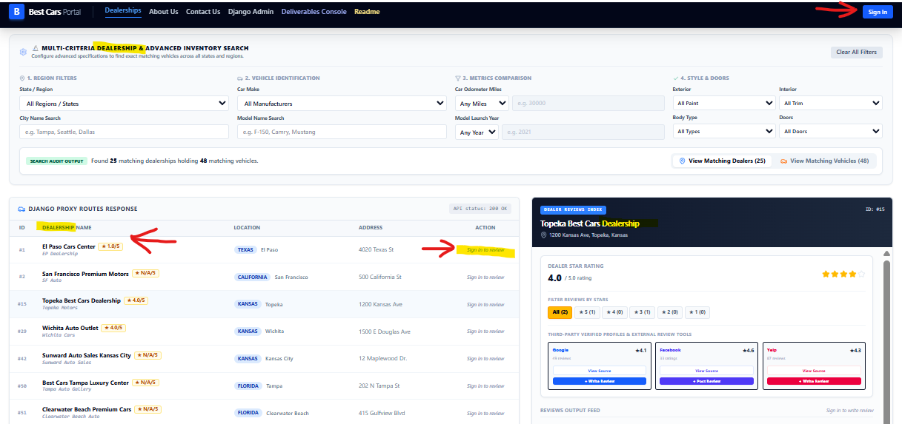

### 2. Dealers Home Page (Logged In)
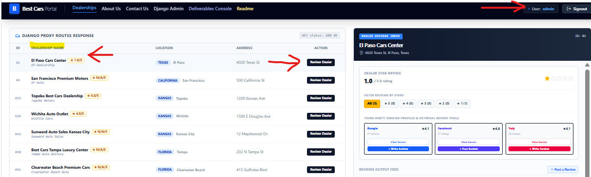

### 3. Filter Dealers by State (Kansas)
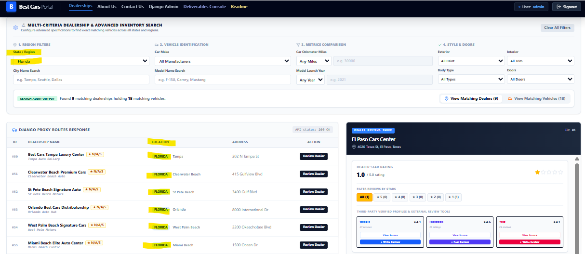

### 4. Dealer Details & Reviews
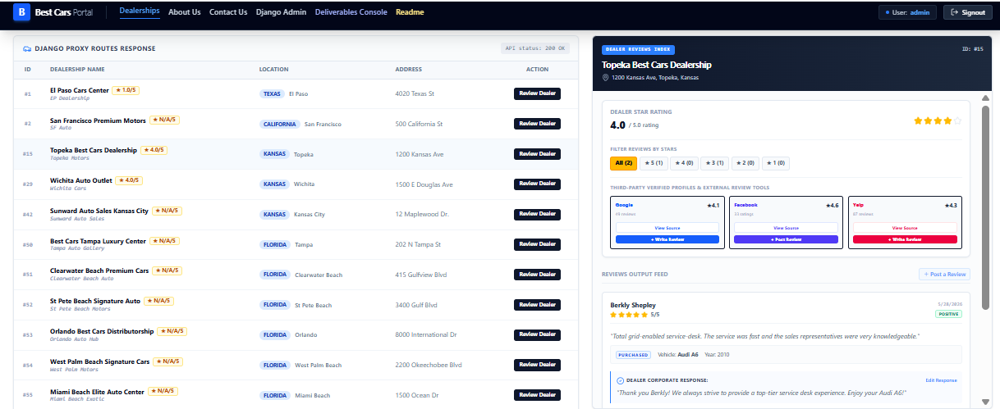

### 5. Submit Review Page
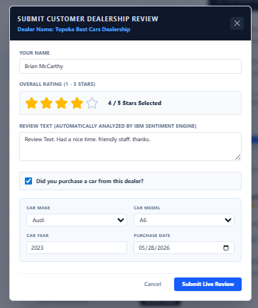

### 6. Review Added Confirmation
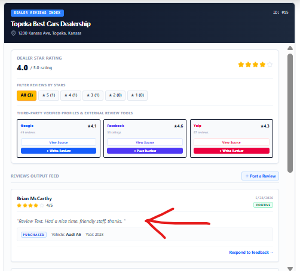

### 7. Deployed Application Landing Page
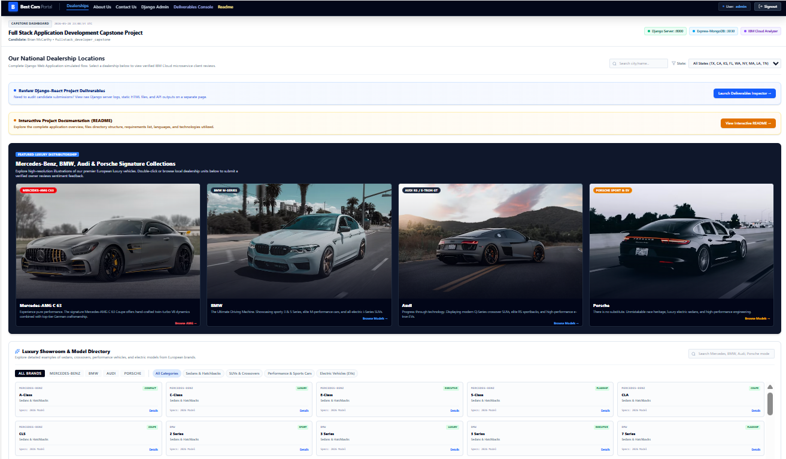

### 8. Deployed Logged-in State
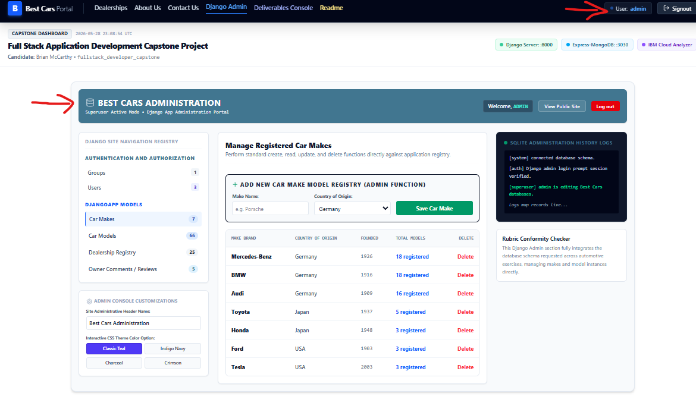

### 9. Deployed Dealer Details Page
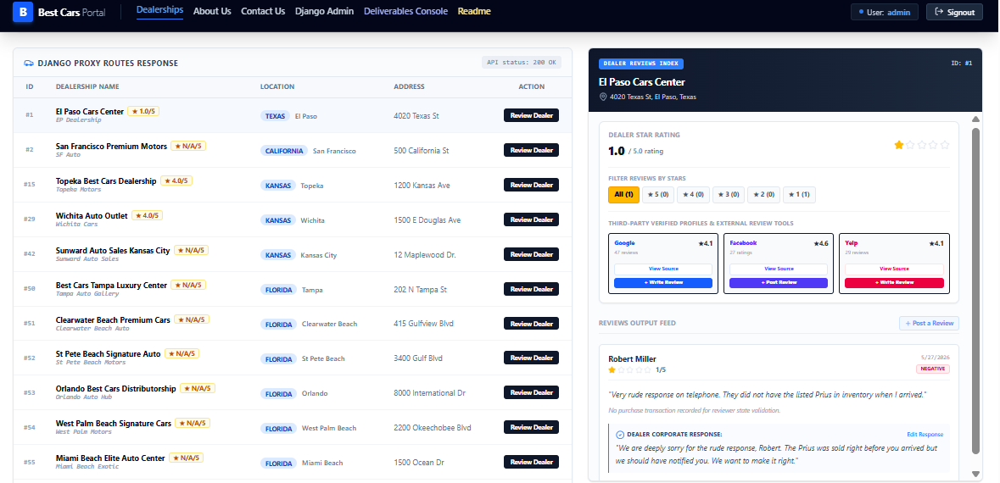

### 10. Deployed Added Review
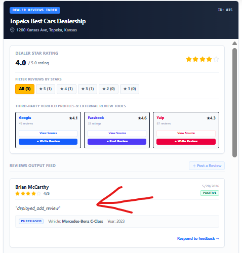

### 11. Django Admin Login & Logout
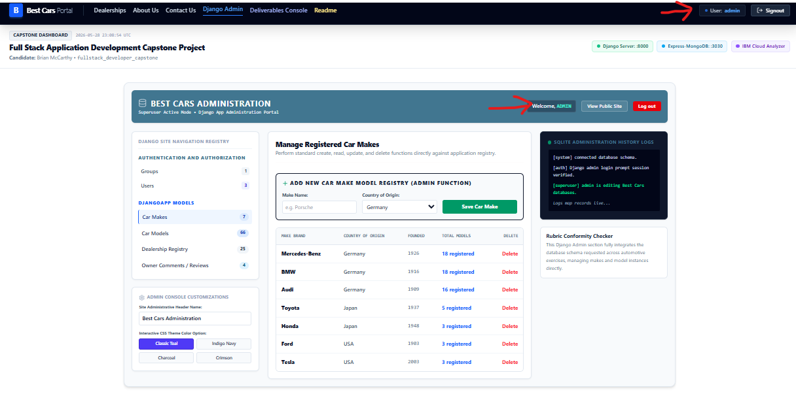
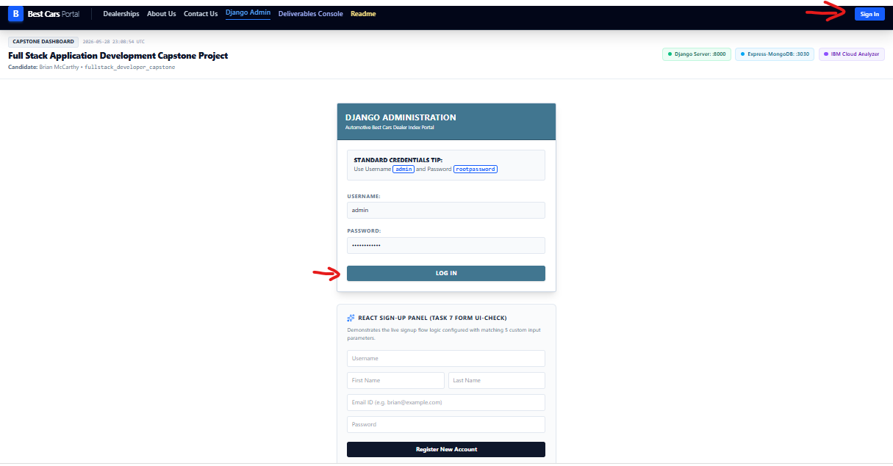
